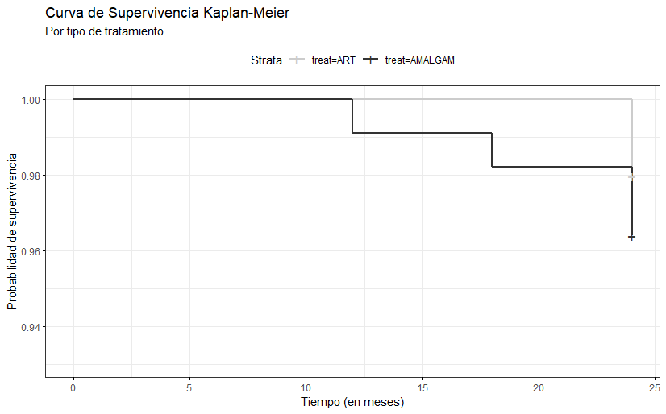

# Análisis de supervivencia de restauraciones dentales: ART frente a amalgama

**EN** — Survival analysis of dental restorations in primary molars of children followed for 24 months (AMAR study data), comparing the Atraumatic Restorative Treatment (ART) with amalgam. The failure event is caries at the cavosurface margin. Kaplan-Meier curves, a life table and a log-rank test found very few failures (2 of 98 ART and 4 of 111 amalgam restorations) and no significant difference between treatments (log-rank p = 0.5).

**ES** — Análisis de supervivencia de restauraciones dentales en molares temporales de niños seguidos durante 24 meses (datos del estudio AMAR), que compara el tratamiento restaurador atraumático (ART) con la amalgama. El evento de falla es la presencia de caries en el margen de la cavosuperficie. Las curvas de Kaplan-Meier, la tabla de vida y la prueba log-rank muestran muy pocas fallas (2 de 98 restauraciones con ART y 4 de 111 con amalgama) y ninguna diferencia significativa entre tratamientos (log-rank p = 0,5).



## Objetivo

Organizar y limpiar la base de datos del estudio AMAR y evaluar estadísticamente si la supervivencia de las restauraciones con ART difiere de la del tratamiento tradicional con amalgama.

## Datos

- `AMAR-DataBase-3-2021 .xlsx`: base original del estudio, incluida en el repositorio. Tiene 209 participantes identificados con un código numérico y estas hojas:
  - `Demographics`: respuestas del cuestionario sociodemográfico y de salud oral, codificadas en 599 columnas indicadoras (sexo, etnia, idioma, edad en años, seguro, hábitos de higiene, etc.).
  - `Baseline data`, `6months`, `12months`, `18months` y `24 months`: evaluación clínica de cada restauración en cada visita.
- `AMAR-CODES(2021)-1.pdf` / `.docx`: libro de códigos del cuestionario y de la evaluación clínica.
- Variables clínicas usadas en el modelo:

  | Variable | Descripción |
  |---|---|
  | `treat` | tratamiento (ART o amalgama) |
  | `totno` | número de diente (molares temporales 54, 55, 64, 65, 74, 75, 84, 85) |
  | `tyoj` | maxilar o mandíbula |
  | `tld` | profundidad de la lesión |
  | `restt` | tipo de restauración |
  | `sense` | sensibilidad en la escala de caras de Wong-Baker |
  | `marga` | adaptación marginal |
  | `anatf` | forma anatómica |
  | `ccm` | caries en el margen de la cavosuperficie |

- `DataForModel.xlsx` y `data_model.RData`: base procesada con un registro por participante (P-1 a P-209), con el indicador de evento y el tiempo hasta el evento o la censura para `ccm` y `anatf`. `table1_ALL.RData` contiene las características basales en formato ordenado.
- Grupos: 98 restauraciones con ART y 111 con amalgama.

## Métodos

- Conversión de las columnas indicadoras del cuestionario a variables categóricas, con el libro de códigos.
- Tabla 1 de características basales por tratamiento y pruebas chi-cuadrado de proporciones (`qwraps2`).
- Construcción de las variables de tiempo hasta el evento, comparando el estado de cada restauración entre las visitas de 0, 6, 12, 18 y 24 meses.
- Tabla de vida por intervalos de 6 meses (`biostat3::lifetab2`).
- Estimador de Kaplan-Meier por tratamiento (`survival::survfit`) y prueba log-rank.
- Modelo de riesgos proporcionales de Cox, con selección stepwise bidireccional por AIC (`StepReg::stepwiseCox`), prueba de riesgos proporcionales (`cox.zph`), residuales de desviación y curvas ajustadas (`survminer`).

## Resultados principales

- La censura por la derecha es muy alta: solo 6 de 209 restauraciones presentaron caries en el margen en 24 meses.
- Kaplan-Meier:

  | Tratamiento | En riesgo | Eventos (mes) | Supervivencia a 24 meses | IC 95 % |
  |---|---|---|---|---|
  | ART | 98 | 2 (mes 24) | 0,980 | 0,952–1,000 |
  | Amalgama | 111 | 4 (meses 12, 18 y 24) | 0,964 | 0,930–0,999 |

- La prueba log-rank no muestra diferencia significativa entre tratamientos (χ² = 0,5 con 1 g.l., p = 0,5). La mediana de supervivencia no es estimable.
- En el modelo de Cox, la selección por AIC retuvo la adaptación marginal: una restauración fracturada o perdida (`marga` = 3) se asocia con un riesgo mucho mayor (coeficiente 5,94; p < 0,001). Como se rechazó el supuesto de riesgos proporcionales para `treat` y las conclusiones no cambiaban, se eligió el modelo de Kaplan-Meier por parsimonia.
- En las características basales, la mayoría de las pruebas chi-cuadrado no mostró diferencias entre grupos. Hubo diferencias en el idioma del niño, la edad de la primera consulta odontológica, la salud oral de los padres y la situación laboral.

## Estructura del repositorio

```
.
├── survival_model.qmd, survival_model.pdf     # Informe final: tabla de vida, Kaplan-Meier y conclusiones
├── modelos_de_supervivencia.qmd, .pdf         # Informe con Kaplan-Meier, modelo de Cox y selección stepwise
├── data_for_model.qmd, data_for_model.html    # Limpieza de las visitas y construcción de los tiempos de evento
├── tabla1_prop.Rmd (+ .html, .nb.html, .pdf)  # Tabla 1 de características basales y pruebas chi-cuadrado
├── model.R, code_model.R                      # Scripts del ajuste (code_model.R se extrajo de survival_model.qmd)
├── Análisis Estadístico.docx, Statistical Analyis.docx   # Resumen de resultados en español e inglés
├── AMAR-DataBase-3-2021 .xlsx                 # Base original del estudio
├── AMAR-CODES(2021)-1.pdf, .docx              # Libro de códigos
├── DataForModel.xlsx, data_model.RData, table1_ALL.RData # Bases procesadas
├── SurvKM.png                                 # Curvas de Kaplan-Meier
├── papers/                                    # Artículos de referencia sobre ART y restauraciones en dientes temporales
├── *_cache/, *_files/                         # Caché y figuras generadas por Quarto y knitr
└── survminer_0.4.9.zip                        # Copia local del paquete survminer
```

## Cómo reproducir

- R (el resumen de resultados menciona R 4.4.2) y Quarto.
- Paquetes: `survival`, `survminer`, `tidyverse`, `magrittr`, `ggalt`, `openxlsx`, `ggfortify`, `kableExtra`, `knitr`, `xtable`, `StepReg`, `biostat3`, `radiant`, `janitor`, `readxl`, `R.utils` y `qwraps2`.
- Orden sugerido:
  1. `data_for_model.qmd` construye la base del modelo a partir del Excel.
  2. `tabla1_prop.Rmd` produce la tabla de características basales.
  3. `survival_model.qmd` o `modelos_de_supervivencia.qmd` ajustan los modelos.

  Los informes cargan `data_model.RData`, así que pueden renderizarse directamente:

```bash
quarto render survival_model.qmd
```

## Contexto y autoría

Proyecto de análisis estadístico sobre los datos del estudio AMAR, desarrollado entre noviembre de 2022 y marzo de 2023.

Autor del análisis: Daniel Villa (Daniel Felipe Villa Rengifo).
